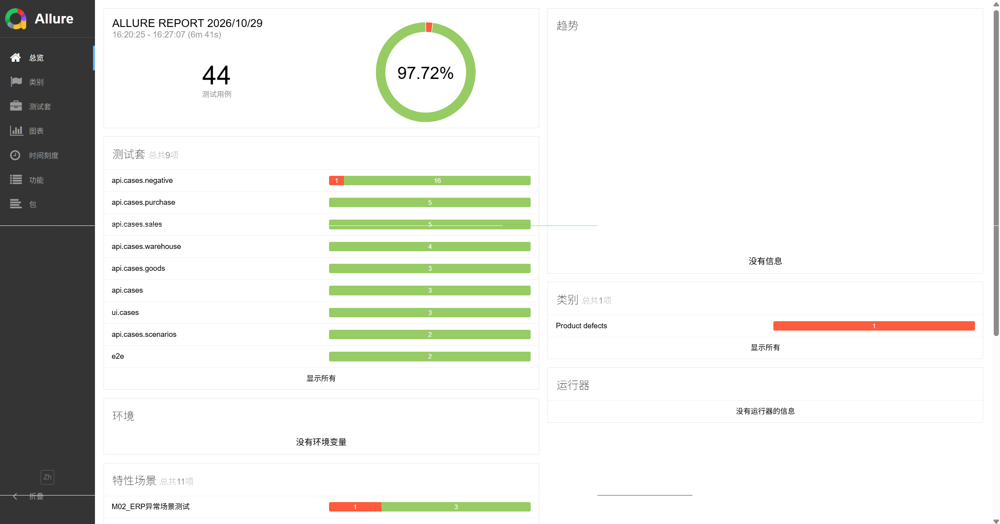
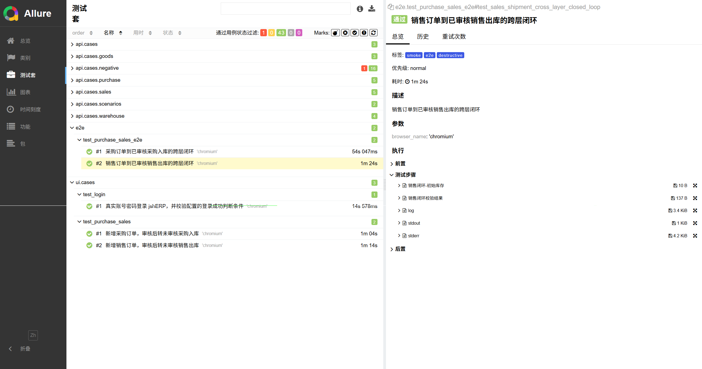
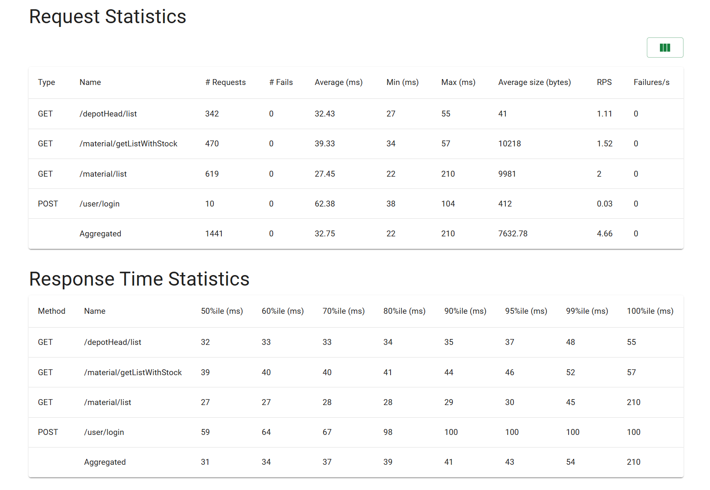
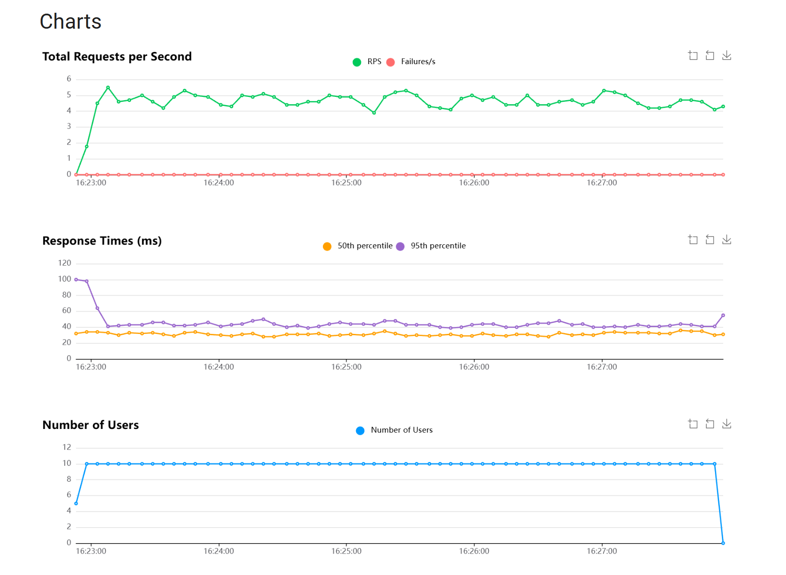

# AutoERP 自动化测试框架

[](https://www.python.org)
[](https://pytest.org)
[](https://playwright.dev/python/)
[](https://allurereport.org)
[](https://locust.io)
[](https://github.com/features/actions)

AutoERP 是基于 Python + pytest、面向 jshERP 进销存业务的自动化测试框架，统一执行 API、UI 与跨层 E2E 测试。项目覆盖商品、仓库、采购和销售等核心业务，用数据驱动和跨层校验减少重复人工回归。

## 📊 实际测试成果

2026-10-29 在真实测试环境完成一轮 pytest 全量执行：**44 条用例，43 Passed / 1 Failed，通过率 97.72%**，耗时 381.52 秒。

| 测试类型 | 用例数 | Passed | Failed |
| --- | ---: | ---: | ---: |
| API 自动化 | 39 | 38 | 1 |
| UI 自动化 | 3 | 3 | 0 |
| E2E 自动化 | 2 | 2 | 0 |
| **合计** | **44** | **43** | **1** |

- 采购入库、销售出库两条跨层 E2E 均通过。
- 唯一失败项是超库存销售出库负向断言：接口实际接受请求，与预期拒绝不一致。
- 后置清理及数据库只读复核通过，未发现本轮测试的有效业务残留，库存已恢复至基准值。

### Allure 全量执行总览



### Allure 测试套件与跨层 E2E



> 以上为本地真实执行结果，保留了已知失败项，不将数据清理成功等同于全部测试通过。

## 目录

- [实际测试成果](#-实际测试成果)
- [技术栈](#-技术栈)
- [项目结构](#-项目结构)
- [技术架构](#-技术架构)
- [测试类型详解](#-测试类型详解)
- [设计亮点](#-设计亮点)
- [配置说明](#-配置说明)
- [测试报告](#-测试报告)
- [CI 持续集成](#-ci-持续集成)
- [快速开始](#-快速开始)
- [License](#-license)

## 🛠 技术栈

| 技术/工具 | 作用 |
| --- | --- |
| Python / pytest | 测试执行、fixture 和 marker 管理 |
| requests / YAML / JSONPath | API 请求、数据驱动和响应字段提取 |
| Playwright | Web UI 自动化、截图、视频和 Trace |
| MySQL / PyMySQL | 数据库断言和测试数据复核 |
| Allure | API、UI、E2E 可视化报告 |
| Locust | 性能测试与 HTML/CSV 输出 |
| GitHub Actions | 代码检查、用例收集与只读连通性检查 |

## 📁 项目结构

```text
AutoERP/
├── .github/workflows/        # GitHub Actions workflow
├── api/                      # API 用例、YAML、Schema 与执行器
├── ui/                       # Playwright 用例、fixture 与 Page Object
├── e2e/                      # UI + API + MySQL 跨层闭环
├── performance/              # Locust 性能测试
├── shared/                   # 公共客户端、断言和数据库辅助方法
├── config/                   # 配置读取与模板
├── images/                   # README 真实运行截图
├── run.py                    # 统一执行入口
└── requirements.txt          # 依赖清单
```

## 🏗 技术架构

```text
                  run.py 统一入口
                         │
 shared / config ──> API / UI / E2E / Locust ──> jshERP Web UI / API / MySQL
                         │
                         └──> Allure / Screenshot / Trace / Locust 报告
```

## 📊 测试类型详解

### API 自动化

YAML 描述请求、变量提取和断言规则，统一执行器负责鉴权、模板替换、requests 调用及 JSONPath/正则提取。用例覆盖商品、仓库、采购、销售、收付款、业务链路和异常边界，并支持 HTTP/业务字段、JSON Schema 与 MySQL 断言。

### UI 自动化

基于 pytest-playwright 和 Page Object，复用登录态，覆盖登录、采购订单转采购入库、销售订单转销售出库。失败时保留 Screenshot、Video 和 Trace；业务数据使用运行 ID 隔离并按已登记 ID 清理。

### 跨层 E2E

采购和销售 E2E 从 UI 创建、转单和审核，再通过 API 查询及 MySQL 金额/库存断言验证结果。测试优先登记真实数据库 ID；清理已审核库存单据时先反审核，再定向删除并复核关联记录和库存恢复。

### 性能测试

Locust 提供 `readonly`、`purchase_write` 和 `sales_write` 场景。2026-08-29 对含登录鉴权的核心只读接口完成一次实际基线测试：

| 指标 | 结果 |
| --- | ---: |
| 最大并发用户数 | 10 |
| 持续时间 | 约 5 分钟 |
| 总请求数 | 1,441 |
| 失败请求数 | 0 |
| RPS | 4.66 |
| 平均响应时间 | 32.75 ms |
| P95 | 43 ms |





该结果仅是特定测试环境、10 用户负载下的只读性能基线，不代表容量上限。采购和销售写入场景仅用于受控环境的短时冒烟，不计入该持续基线。

## ✨ 设计亮点

| 特性 | 说明 |
| --- | --- |
| 统一执行与数据驱动 | `run.py` 统一 API、UI、E2E 入口，API 用 YAML 描述请求、提取和断言 |
| 会话上下文与多层断言 | 隔离鉴权和提取变量，支持响应、Schema 及数据库断言，并输出可定位的失败信息 |
| UI 与跨层闭环 | Page Object 组织页面操作，E2E 串联 UI、API 和 MySQL 验证业务结果 |
| 数据隔离与清理 | 运行 ID 隔离数据，登记真实单据 ID，处理反审核、关联记录清理和库存恢复 |
| 失败现场留存 | Allure 附件及 Playwright Screenshot / Video / Trace 辅助复现问题 |

## ⚙ 配置说明

本地可使用环境变量或未提交的 `config/local.ini`，模板见 `config/local.ini.example`；多环境结构参考 `config/environments.yaml.example`。不要把真实账号、密码或密钥写入仓库和报告。

| 配置组 | 核心变量 |
| --- | --- |
| 环境与服务 | `ERP_ENV`、`ERP_API_URL`、`ERP_UI_URL` |
| 登录与数据库 | `ERP_USERNAME`、`ERP_PASSWORD`、`MYSQL_HOST`、`MYSQL_PORT`、`MYSQL_USERNAME`、`MYSQL_PASSWORD`、`MYSQL_DATABASE` |
| 业务基础数据 | `ERP_CATEGORY_ID`、`ERP_DEPOT_ID`、`ERP_SUPPLIER_ORGAN_ID`、`ERP_CUSTOMER_ORGAN_ID`、`ERP_SETTLE_ACCOUNT_ID`、`ERP_FINANCE_ACCOUNT_ID` |
| UI 登录判断 | `ERP_UI_LOGIN_SUCCESS_KIND`（`url` / `title` / `text`）、`ERP_UI_LOGIN_SUCCESS_VALUE` |

## 📈 测试报告

本地执行会生成 Allure、JUnit 和调试产物，失败用例可结合断言附件、Screenshot 与 Trace 定位。

| 产物 | 路径 |
| --- | --- |
| Allure 原始结果 | `reports/allure-results/<类型>/<运行 ID>/` |
| Allure HTML 报告 | `reports/allure-report/<类型>-<运行 ID>/` |
| Playwright Screenshot / Video / Trace | `reports/playwright/` |
| Locust HTML、CSV、日志 | `reports/locust/` |

通过 `run.py` 统一入口运行测试后，会生成 Allure 原始结果和 HTML 报告；非 CI 环境下会尝试自动打开，HTML 报告保存在 `reports/allure-report/`。

2026-10-29 的全量 Allure 原始文件仅保留在本地历史目录，未上传 GitHub；公开仓库只展示上方脱敏截图。`.runtime/auth/` 是本地登录态，也不属于报告产物。

## 🔄 CI 持续集成

| 文件 | 用途 |
| --- | --- |
| `.github/workflows/quality-gate.yml` | Push / PR / 手动触发的轻量检查与用例收集 |
| `.github/workflows/api-test.yml` | Push 代码检查和收集；手动选择 API 套件执行 |
| `.github/workflows/performance-tests.yml` | 手动只读性能预检与受控基线执行 |

- Push / PR 的 `quality-gate.yml` 执行编译、API/UI/E2E collect-only 及 API/UI 只读连通性检查，不执行云端业务写入。
- `api-test.yml` 的手动真实 API 回归尚无已验证的数据库清理连接保障，当前不应直接触发。
- `performance-tests.yml` 仅允许手动 `readonly` 场景，最多 10 用户、最长 5 分钟，并先执行 1 用户、1 分钟预检。
- CI 通过 GitHub Secrets 注入配置，只归档受限 JSON 摘要，不上传完整 Allure、JUnit、Trace、截图、Locust CSV 或日志。当前不声明这些工作流已在 GitHub Runner 上完成真实回归验证。

## 🚀 快速开始

### 环境准备

```bash
git clone https://github.com/C0LUMN7/AutoERP.git
cd AutoERP
python -m venv .venv
source .venv/bin/activate
pip install -r requirements.txt
```

```bash
cp config/local.ini.example config/local.ini
python -m playwright install chromium
```

填写 `config/local.ini` 或导出环境变量。API/UI/E2E 实际执行还需要已加入 `PATH` 的 Allure CLI；UI/E2E 需要对应 Playwright 浏览器。

### 收集检查

```bash
python run.py preflight
python run.py api --collect-only
python run.py ui --collect-only
python run.py e2e --collect-only
```

### 运行命令

> 部分 API、UI、E2E 用例会真实创建 ERP 单据并影响库存，只能在隔离测试环境运行，并须提前确认数据库连接和清理机制可用。`collect-only` 仅检查用例收集，不代表真实执行或清理验证。

```bash
# 代表性回归
python run.py api --suite smoke
python run.py ui --suite smoke
python run.py e2e --suite smoke

# 只读性能场景
python run.py performance --scenario readonly --users 1 --spawn-rate 1 --run-time 1m
```

其他套件、浏览器、受控写入性能和显式通知参数可通过 `python run.py --help` 查看。当前全量 API 测试包含一条已知的超库存负向断言失败，因此全量运行可能返回非零退出码。

## 📝 License

本项目采用 MIT 许可证 - 详见 [LICENSE](LICENSE) 文件，仅供学习和求职展示使用。
